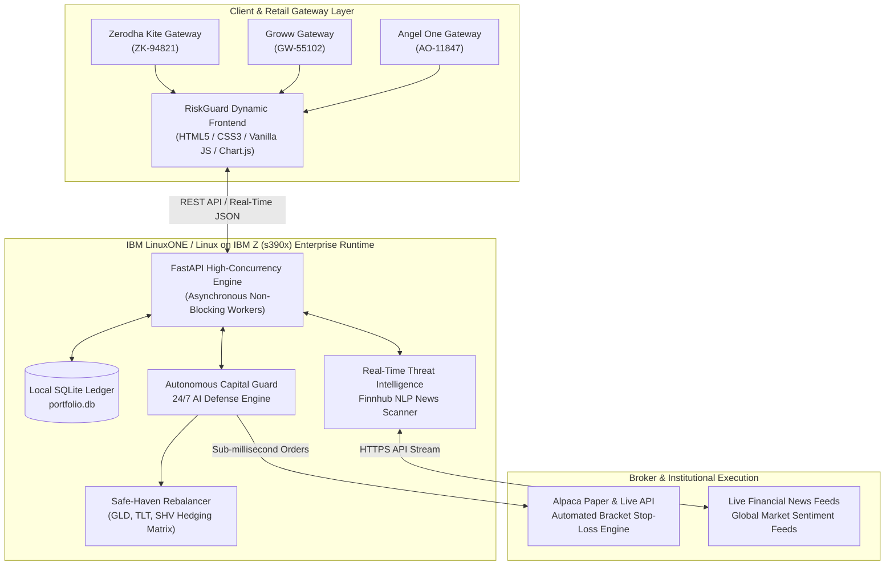

# RiskGuard AI — Autonomous Capital Defense Engine

[](https://github.com/RAYAPURAMVIKRAM/_6_IBM_DATATHON)
[](https://github.com/RAYAPURAMVIKRAM/_6_IBM_DATATHON)
[](https://opensource.org/licenses/MIT)
[](https://fastapi.tiangolo.com)
[](https://www.ibm.com/it-infrastructure/linuxone)

> **IBM Z Datathon 2026 | Real-Time AI for Critical Decisions**

---

## 📌 Executive Summary

### ⚠️ Problem Statement
> **"Everyday investors lose savings during market flash crashes because they lack the real-time AI tools used by institutions to instantly detect risks and execute automated protective actions."**

During turbulent flash-crash events, retail brokerage platforms frequently freeze or suffer high-latency bottlenecks while algorithmic hedge funds dump high-beta equities in microseconds. Retail investors are left holding devaluing assets without automated safety rails.

### 💡 Proposed Solution
> **"A real-time AI risk agent that analyzes live market data and news to instantly execute automated protective actions, safeguarding retail investors from sudden financial crashes."**

**RiskGuard AI** continuously scans market feeds and live financial journalism for systemic threat signals, runs real-time NLP sentiment analysis, and executes instantaneous bracket stop-losses and safe-haven portfolio hedging (GLD, TLT, SHV) via automated broker gateways before losses compound.

---

## 🏛️ System Architecture & IBM LinuxONE Deployment



### Why IBM LinuxONE?
- **Enterprise-Grade Uptime (99.999%)**: Financial capital defense requires unyielding continuity; IBM LinuxONE and IBM Z provide uninterrupted availability even during record market volume surges.
- **Microsecond Latency & CPACF Acceleration**: Hardware-accelerated cryptographic coprocessors (CPACF) ensure instant API credential verification and order signing with zero latency overhead.
- **Pervasive Encryption**: Safeguards confidential portfolio allocations and proprietary brokerage tokens directly in hardware-protected memory envelopes.
- **s390x Architecture Scalability**: LinuxONE handles thousands of simultaneous retail portfolio threat evaluations concurrently without thermal throttling or dropped websockets.

---

## 🚀 Core Features

- 🌐 **Multi-Broker Gateway Simulation**:
  - One-click seamless authentication simulation for India's leading brokerages: **Zerodha Kite**, **Groww**, and **Angel One**.
  - Dynamic client session badges (`ZK-94821`, `GW-55102`, `AO-11847`) with instantaneous broker-scoped theme switching (Zerodha Orange `#f6461a`, Groww Mint `#00d09c`, Angel One Royal Blue `#1e56a0`).

- 🛡️ **24/7 Autonomous AI Defense Engine**:
  - Server-side state guard switchable via interactive radar aura controls.
  - Active autonomous defense triggers immediate protective stop-losses upon identifying market-wide threat catalysts.

- ⚡ **Instant Stop-Loss Execution**:
  - One-click and automated algorithmic liquidation via Alpaca paper execution API.
  - Real-time order ID generation and visual transaction lifecycle feedback.

- 💎 **Safe-Haven Rebalancing Matrix**:
  - Automatically computes defensive capital allocation shifts into uncorrelated preservation assets:
    - **GLD (SPDR Gold Shares)** — Inflation & systemic shock hedge.
    - **TLT (20+ Year Treasury Bond ETF)** — Flight-to-safety duration hedge.
    - **SHV (Short Treasury Bond ETF)** — Cash-equivalent capital preservation.

- 💱 **Dynamic Dual-Currency Conversion**:
  - Real-time toggle between **USD ($)** and **INR (₹)** with precise asset valuation calculation across all positions and portfolio metrics.

- 📊 **Interactive Market Visualization**:
  - Embedded Chart.js engine displaying live technical indicators, 50-day moving averages, and dynamic resistance channels adapted to active broker themes.

---

## 🛠️ Technology Stack

| Layer | Component | Description |
| :--- | :--- | :--- |
| **Backend** | Python 3.10+ / FastAPI | High-performance, asynchronous REST backend engine |
| **Database** | SQLite3 (`portfolio.db`) | Local persistent ledger for equity holdings and executions |
| **Market Intelligence**| Finnhub API | Real-time global market news & NLP sentiment parsing |
| **Broker Execution** | Alpaca Trade API | Institutional-grade paper trading and automated order routing |
| **Frontend** | HTML5 / CSS3 / JavaScript | Modern glassmorphic responsive dashboard with dark/light auto-theme |
| **Visualization** | Chart.js | Hardware-accelerated canvas chart rendering |
| **Hardware / OS** | IBM LinuxONE / RHEL for s390x | Enterprise mainframe architecture for real-time mission-critical AI |

---

## 📂 Project Structure

```text
_6_IBM_DATATHON/
├── .gitignore              # Excludes .env, bytecode, logs, and OS caches
├── .env.example            # Environment variables template
├── requirements.txt        # Python dependency manifest
├── main.py                 # FastAPI backend, Finnhub scanner & Alpaca executor
├── portfolio.db            # SQLite database with blue-chip holdings ledger
├── README.md               # Executive project documentation
└── static/
    ├── index.html          # Interactive multi-broker capital defense portal
    ├── style.css           # Pure White / Pitch Black & broker theme engine
    └── app.js              # State manager, Chart.js controller & API client
```

---

## ⚙️ Installation & Setup Instructions

### 1. Prerequisites
- Python 3.10 or higher
- Git
- Finnhub API Key ([finnhub.io](https://finnhub.io/))
- Alpaca Paper Trading Keys ([alpaca.markets](https://alpaca.markets/))

### 2. Clone the Repository
```bash
git clone https://github.com/RAYAPURAMVIKRAM/_6_IBM_DATATHON.git
cd _6_IBM_DATATHON
```

### 3. Create & Activate Virtual Environment
**On Linux / macOS:**
```bash
python3 -m venv venv
source venv/bin/activate
```

**On Windows (PowerShell):**
```powershell
python -m venv venv
.\venv\Scripts\Activate.ps1
```

### 4. Install Dependencies
```bash
pip install -r requirements.txt
```

### 5. Configure Environment Variables
Copy `.env.example` to `.env` and enter your API keys:
```bash
cp .env.example .env
```
Edit `.env`:
```env
FINNHUB_API_KEY=your_finnhub_api_key_here
ALPACA_API_KEY=your_alpaca_api_key_here
ALPACA_SECRET_KEY=your_alpaca_secret_key_here
ALPACA_BASE_URL=https://paper-api.alpaca.markets/v2
```
*(Note: If API keys are omitted, RiskGuard AI gracefully defaults to robust mock simulation data for sandbox demonstrations).*

### 6. Run the Application
Start the high-concurrency FastAPI server using Uvicorn:
```bash
uvicorn main:app --reload
```
Navigate to `http://127.0.0.1:8000` in your web browser.

---

## 🔌 API Endpoints Reference

| Method | Endpoint | Description |
| :--- | :--- | :--- |
| `GET` | `/` | Serves the interactive RiskGuard AI dashboard |
| `GET` | `/api/holdings` | Returns list of current equity holdings from SQLite |
| `GET` | `/api/threat-intel` | Scans Finnhub news for high-risk crash signals |
| `GET` | `/api/defense-status` | Fetches active AI defense status and master switch state |
| `POST`| `/api/toggle-defense` | Toggles 24/7 autonomous capital defense ON/OFF |
| `POST`| `/api/emergency-stop-loss`| Dispatches immediate bracket stop-loss order to Alpaca |
| `GET` | `/api/safe-havens` | Returns allocation guidance for GLD, TLT, and SHV |

---

## 🏆 Datathon Submission Details

- **Event**: IBM Z Datathon 2026
- **Track**: Real-Time AI for Critical Decisions
- **Repository**: [https://github.com/RAYAPURAMVIKRAM/_6_IBM_DATATHON](https://github.com/RAYAPURAMVIKRAM/_6_IBM_DATATHON)
- **Engine**: RiskGuard AI Capital Defense Engine
Live working deployment: http://148.100.98.175:8000/

---

## 📜 License
Distributed under the MIT License. See `LICENSE` for more information.
